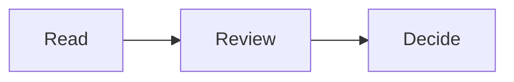

# SpecDown platform testing runbook

Use this runbook for a **named build on a named, authorized host**. It is a reusable procedure, not authorization to install software, reach another computer, use signing credentials or publish a release. Writing this document did not execute these tests.

Windows and Linux need more hands-on coverage than macOS. A passing package job proves that an installer was produced; it does not prove that installation, file watching, keyboard input or printing work on a user's desktop.

## Choose the evidence you need

| Mode | Input | What a pass establishes |
| --- | --- | --- |
| Release artifact | An exact published installer/AppImage/DMG or approved CI artifact, with recorded hash | Behavior of those bytes on the recorded host. Do not rebuild or patch the app during this run. |
| Source development | A clean, exact Git revision in a separate checkout | Tests/build/runtime behavior of that source and local toolchain. It is not verification of a downloaded release. |
| Store/native supplement | An explicitly authorized Dev, TestFlight or Store build | Behavior of that exact identity/build on the recorded native device. Different channels and older builds are not interchangeable evidence. |

At the November 2, 2026 checkpoint, direct desktop **0.0.232** was published; production iOS/Mac Store and refreshed Dev/Beta were **1.0.1 (230)**. These are historical starting points, not instructions to select whichever build is now latest. [Session 77](../project-appstore/2026-11-02-tasks-session-77-direct-desktop-232-published.md) records direct artifact/public-feed verification; [Session 78](../project-appstore/2026-11-02-tasks-session-78-test-channels-signing-handoff.md) records separate Dev/Beta identities and pending owner acceptance.

## Host, permissions and isolation — before launching

1. Obtain authorization for this host, selected build/channel and actions. Record separately whether installation, a disposable upgrade, uninstall, file associations, OS account/VM creation and source dependency installation are allowed. A testing request is not permission to sign, upload, submit, release, change account security or create keys.
2. **Do not connect from Chris's Mac to another computer** through SSH, remote desktop, network shares or another transport. Give this runbook to an agent/user already authorized to work locally on the Windows/Linux host. This runbook does not expand that boundary. Use only explicitly approved services/download sources.
3. Prefer an owner-approved disposable OS user or an already approved disposable local VM with a graphical session. Do not create one, elevate privileges or install system prerequisites without the applicable authorization. A VM result is a VM result, not a physical-device pass.
4. Test only synthetic Markdown, synthetic notes and that disposable account's app state. Keep fixtures, downloads, screenshots and exports in a new test directory. Never copy or inspect the owner's existing notes, browser profile, document history, credential store or production app data. Do not reinstall over an existing owner installation to obtain a clean state.
5. A fixture directory alone does **not** isolate Electron app data, OS recents, file associations, shortcuts or session restore. The current app writes state under Electron `userData`. Do not assume `--user-data-dir`, changing `HOME`, a renamed executable or another working directory isolates all of it. If using an alternative to a disposable OS account, first prove the exact tested channel isolates both Electron state and OS integration; otherwise stop as **BLOCKED**. A test harness that replaces Electron services is source-test evidence, not untouched artifact evidence.
6. Record OS version/architecture, physical vs VM, Windows display scaling or Linux desktop/compositor and X11/Wayland, locale, display resolution and input method. Use a standard user, not root/Administrator. Keep Defender/SmartScreen, Gatekeeper, Linux sandbox/AppArmor and Electron web/sandbox protections enabled. Never add `--no-sandbox`, `--disable-web-security`, quarantine-removal commands or broad filesystem permissions to make a test pass.
7. If a security prompt blocks an unsigned installer, record the exact prompt and stop that step. Do not bypass it on the owner's behalf. An unsigned artifact and an invalid signature are different findings. An artifact hash establishes byte identity, not publisher trust.

## Record exact provenance

For an artifact, retain its versioned download URL, release tag, source commit from the release/build record, workflow/run ID when available, filename, byte count and SHA-256. Record the installed version, executable path and channel after installation. A filename or About dialog alone cannot bind an installer to a source revision. If the source mapping or independent expected hash is unavailable, label that gap; do not invent it.

Use the exact file already downloaded from the approved source. Substitute its local path below. These commands inspect a file; they do not install it.

**Windows PowerShell:**

```powershell
$artifact = 'C:\path\to\Specdown-Desktop-Setup-VERSION.exe'
Get-Item -LiteralPath $artifact | Select-Object Name, Length
Get-FileHash -LiteralPath $artifact -Algorithm SHA256
Get-AuthenticodeSignature -LiteralPath $artifact |
  Select-Object Status, StatusMessage, SignerCertificate, TimeStamperCertificate
```

**Linux shell:**

```sh
artifact='/path/to/Specdown-Desktop-VERSION.AppImage'
stat -c '%n %s bytes' -- "$artifact"
sha256sum -- "$artifact"
file -- "$artifact"
```

Compare the result to the independently retained build/release manifest when one exists. Save both the expected digest's source and the calculated digest. Do not treat two hashes calculated from the same download as independent verification. The current direct Windows/Linux release lane is unsigned; record that fact instead of claiming Authenticode/notarization. Linux has no equivalent of a macOS notarization check in this lane.

For source mode, record `git remote -v`, `git branch --show-current`, `git rev-parse HEAD`, `git status --short`, Node/npm versions and the lockfile hash in the separate checkout. Inspect remotes before logging them so an embedded credential is not exposed. Preserve a dirty checkout; use a new approved worktree/checkout rather than resetting it. On Chris's Mac, worktrees belong under `/Users/chrisbremer/code/specdown/.claude/worktrees/`, while the canonical Xcode checkout remains preserved.

## Prepare synthetic fixtures

Run only after the host/isolation gate passes. Both examples create a new directory and UTF-8 files; neither opens the app. The oversized file is bounded to 9 MiB, just above the current 8 MiB document limit. Recheck limits in the tested source before interpreting a future build.

**Windows PowerShell:**

````powershell
$qaRoot = Join-Path ([IO.Path]::GetTempPath()) ('specdown-qa-' + [guid]::NewGuid())
New-Item -ItemType Directory -Path $qaRoot | Out-Null
New-Item -ItemType Directory -Path (Join-Path $qaRoot 'other') | Out-Null
$utf8NoBom = New-Object System.Text.UTF8Encoding($false)
$fixture = @'
# SpecDown synthetic check

Revision 1. Find the word architecture. Unicode: café 日本語.

| Item | State |
| --- | --- |
| Reading | Ready |



## Final section

This text must remain visible in print and PDF output.
'@
[IO.File]::WriteAllText((Join-Path $qaRoot 'check.md'), $fixture, $utf8NoBom)
[IO.File]::WriteAllText((Join-Path $qaRoot 'other\check.md'), '# Different document', $utf8NoBom)
[IO.File]::WriteAllText((Join-Path $qaRoot 'space name.markdown'), "# Spaces`r`nCRLF text", $utf8NoBom)
[IO.File]::WriteAllText((Join-Path $qaRoot 'oversize.md'), ('x' * (9 * 1024 * 1024)), $utf8NoBom)
[IO.File]::WriteAllBytes((Join-Path $qaRoot 'invalid-utf8.md'), [byte[]](0xC3, 0x28))
$qaRoot
````

**Linux shell with Python 3:**

````sh
qa_root=$(mktemp -d "${TMPDIR:-/tmp}/specdown-qa.XXXXXX")
python3 - "$qa_root" <<'PY'
from pathlib import Path
import sys
root = Path(sys.argv[1])
(root / 'other').mkdir()
text = '''# SpecDown synthetic check

Revision 1. Find the word architecture. Unicode: café 日本語.

| Item | State |
| --- | --- |
| Reading | Ready |


## Final section

This text must remain visible in print and PDF output.
'''
(root / 'check.md').write_bytes(text.encode('utf-8'))
(root / 'other' / 'check.md').write_bytes(b'# Different document')
(root / 'space name.markdown').write_bytes(b'# Spaces\r\nCRLF text')
(root / 'oversize.md').write_bytes(b'x' * (9 * 1024 * 1024))
(root / 'invalid-utf8.md').write_bytes(bytes([0xC3, 0x28]))
PY
printf '%s\n' "$qa_root"
````

If Python is absent, use an approved editor to create equivalent bounded fixtures; record the difference. Do not install tools implicitly. Later edit/rename/delete only these created fixtures. Retain the original fixture text and exact steps used for each mutation.

## Install and launch the selected artifact

**Windows:** use the exact NSIS installer interactively in the disposable account. The configured installer is not one-click and allows choosing its installation directory. Record the actual per-user/machine scope offered, destination and prompts; do not assume its scope from the filename. Stop if elevation or a security exception is needed but not authorized. Keep existing file defaults unless a disposable association test was separately approved. Record shortcut/Start-menu behavior and the installed executable's version. Launch that specific installation, not an older pinned shortcut.

**Linux:** after provenance and permissions are approved, mark only the downloaded AppImage executable and launch it from the graphical session:

```sh
chmod u+x -- "$artifact"
"$artifact"
```

Do not run it as root. If FUSE, a shared library, a sandbox policy or display access is missing, capture the error and mark the launch blocked. Installing packages, changing user namespaces/AppArmor or using an extracted AppImage is a separate approved experiment, not a successful normal AppImage launch. Record distro/version, Wayland vs X11, GPU/display scaling and whether file-manager integration was actually offered. Never infer a `.desktop` registration from an AppImage file existing.

**Mac direct supplement:** use an explicitly approved separate test account/install, verify the exact DMG/ZIP and signed app, and follow the recorded signature/Gatekeeper/notarization gates in Session 77. The shipped 232 Mac app requires macOS 13+. Direct Mac auto-update may download/install a newer release on quit. For a fixed-artifact test, either use an authorized offline session or the implemented `SPECDOWN_DISABLE_UPDATER=1` in that app process's environment, documenting the choice. That is not an update test. It does not authorize changing security protections or blocking unrelated network traffic.

For native iOS/MAS identities, provisioning and acceptance, use the [channel specification](../project-appstore/2026-10-31-spec-ios-development-channels.md), [Mac test-channel setup](../project-appstore/2026-11-02-tasks-session-71-store-test-channels.md), [MAS file-access contract](../project-appstore/mas-interface.md) and [Session 78](../project-appstore/2026-11-02-tasks-session-78-test-channels-signing-handoff.md). Never use the production bundle ID for an ordinary side-by-side Dev test. These links do not grant signing or account permission.

## Behavioral matrix

Run through the actual UI. Record a result for each row; split rows when only part passes. A screenshot of the welcome screen is not completion of the matrix.

| ID | Action using synthetic data | Expected observation / evidence |
| --- | --- | --- |
| D01 | Fresh install and launch; quit/relaunch with no document | Correct version/channel; clean welcome, no crash or unexpected `QA.md`/`qa-moved.md` permission request. Capture any startup prompt before dismissing it. |
| D02 | Open `check.md` using File → Open; drag a second file; cancel the picker | Content/title/tabs correspond to accepted files; cancel leaves current state unchanged. Drag-and-drop and picker are separate results. |
| D03 | Open the spaces/Unicode fixture and `other/check.md` | Correct content and distinct tabs/recents despite the same basename. No accidental path decoding or case-normalization assumption. |
| D04 | Open Folder; browse and open a file; choose File → Close Folder | Sidebar/workspace closes, current document stays open. Close Folder disables when no folder is open. Reopen another folder without resurrecting stale entries. |
| D05 | Enable the file's Live reload; externally change Revision 1 to Revision 2; then disable it and write Revision 3 | Enabled view updates without reopening; disabled view stays stable until an explicit refresh. Record latency and toggle state. Test ordinary write and an editor-style temporary-file rename separately. |
| D06 | Rename/move/delete only an open fixture; retry via recents; cancel recovery | Clear missing/permission feedback, responsive UI, no silent substitution or unrelated read. Do not require a moved file to reconnect without permission/proven continuity. Restoring a fixture is not proof of durable bookmark recovery. |
| D07 | Attempt invalid UTF-8, 9 MiB content and malformed Mermaid while a valid file is open | Rejected documents preserve current content/title/tabs/recents; malformed diagram reports a bounded diagram error. Test manual refresh and watched replacement separately where supported. No crash, hang or partial document admission. |
| D08 | Open enough small synthetic files to reach the documented tab limit; attempt one more | Rejection preserves existing tabs, active view and accepted recents. Do not infer accepted opening from a successful filesystem read alone. |
| D09 | Open/reopen accepted recents, then cancel a picker and reject a file | App recents reflect successful admission; failed/canceled attempts do not displace valid entries. OS recents, if available, are a separate observation in the disposable account. |
| D10 | Mermaid inline/fullscreen; pan, zoom, reset, fit, resize and close | Diagram remains centered as designed, zoom controls target diagram center, text stays legible and controls remain reachable. PNG/SVG are available on desktop; **no diagram Link control**. |
| D11 | Find `architecture`; navigate matches; Escape; use Tab/Shift+Tab and Enter/Space | Correct matches, visible focus and normal dismissal. Cmd on Mac / Ctrl on Windows/Linux. Find cannot take hidden focus behind fullscreen/presentation; Escape closes the topmost mode without unwanted underlying action. |
| D12 | Switch raw/preview, tabs, theme and document while a diagram/presentation is open | Accepted context changes close obsolete overlays; rejected/background-only changes preserve the current view. Late rendering does not paint another document or steal a newer dialog's focus. |
| D13 | Light/dark themes, OS scaling and a narrow window; choose another app icon and restart | Readable controls and diagrams; selected preference persists within the test account. Current desktop choices affect the running Dock/window, not Finder or installed shortcuts. Desktop currently has seven choices; eight-way parity including Light is separate future work. |
| D14 | Export one diagram as PNG and SVG to the test directory; reopen with an approved local viewer | Actual nonempty files, valid format, complete diagram and sensible bounds; cancellation leaves no false success. Do not upload exports or mistake browser downloads for native iOS export. |
| D15 | Print a multi-page synthetic document and Export as PDF | Print dialog attaches to the visible window; cancel safely. Save PDF only in test directory using an available local PDF destination. Verify first/middle/final sections and diagrams across pages, not just the viewport; no physical printer job without permission. |
| D16 | Quit/relaunch with two files, scroll position and theme; later repeat after closing a folder/file | Only this account/channel's intended session returns; closed workspace stays closed. Missing files produce recoverable feedback, not a forced endless locate loop. Inspect only the disposable session/log. |
| D17 | If notes are in scope, create/export a few synthetic notes and use only currently available import controls in a second disposable store | Record current behavior, errors and export file hashes. Existing annotation export/import is **not** the proposed complete identity/backup/restore system. Do not test with owner notes, assume same-name isolation, claim arbitrary-size lossless recovery or enable iOS annotations. Use the [36-case recovery contract](../project-appstore/2026-10-31-spec-annotation-recovery-contract.md) for a separately authorized feature candidate. |
| D18 | Help → Check for Updates, only when network use is approved | Current unsigned Windows/Linux direct builds open the Releases page; they do not silently install updates. MAS has no direct updater UI. A public feed response and a correct versioned asset hash are separate from an actual authorized upgrade. |

For Windows, additionally observe installer/uninstaller prompts, taskbar/window vs shortcut icons, drive-letter/spaces/non-ASCII paths, file association behavior if authorized, CRLF, and native watchers after atomic saves. Do not use UNC paths/network shares without a separate explicit scope change.

For Linux, additionally observe FUSE/dependency/sandbox startup errors, file picker and print portal, X11/Wayland focus, scaling/GPU issues, case-sensitive filenames, rename-based saves and watcher behavior. If printing or a window manager feature is unavailable, mark that case BLOCKED, not PASS. Do not change kernel limits or security settings to conceal a failure.

## Upgrade, uninstall and update-feed checks are separate

Fresh-install approval does not automatically authorize an upgrade/uninstall. Use a separately approved disposable account/VM and an exact older artifact. Seed only synthetic settings, documents and notes; retain an independently readable backup and before-state record. Verify the intended same-channel upgrade preserves them, and test rejected/failed upgrade paths without touching another installed channel. Test uninstall only on that disposable install; document whether it retains app data and associations. Never delete data automatically to obtain a pass, and do not claim a downgrade is supported without a separate test.

Current direct release mechanics are defined in [.github/workflows/desktop.yml](../../.github/workflows/desktop.yml): exact tag/source resolution, protected signing approval, all three platform jobs, then a separate protected publication step. Preview runs are unsigned and artifact-only. [desktop-validation.yml](../../.github/workflows/desktop-validation.yml) packages unsigned PR artifacts; [ci.yml](../../.github/workflows/ci.yml) runs Linux and Windows source tests. None of those jobs is a physical GUI test.

Compare `latest.yml`, `latest-linux.yml` and `latest-mac.yml` version, asset names, byte sizes and SHA-512 against the **actual** artifacts when authorized to inspect feeds. Report malformed/missing feeds separately from runtime bugs. Do not publish/edit feeds, replace tags or dispatch release workflows from this runbook. Unsigned Windows/Linux auto-update remains intentionally disabled in `desktop/main.js`; Mac direct and Store update mechanisms have different acceptance tests.

## Optional source-development commands

Run this section only if source testing/dependency installation was requested on the target host. Use the exact separate checkout under the safe account, verify its clean revision, and inspect `package.json`/lockfile before `npm ci`. The recorded CI Node range is **22.22.0 ≤ version < 23**; refresh it from the checked-out workflow rather than silently switching toolchains. Stop on the first failed command and keep the log.

The optional package commands below use a **clean child environment**, retaining only basic OS/tool paths and the disposable account's locations. They do not inherit signing/upload credentials or change the parent environment. Inspect the checked-out build configuration and hooks first: if an explicit certificate, signing identity, cloud signer, notarization or credential-bearing config/service is configured, stop and obtain a reviewed unsigned-build plan. Do not read credential values or remove hooks to get around it. `CSC_IDENTITY_AUTO_DISCOVERY=false` alone does not block an explicit `CSC_LINK`/cloud signing configuration, and `--publish never` prevents publication, not signing. The examples match the current direct config, not MAS or arbitrary future configs.

**Windows PowerShell:**

```powershell
node --version
npm --version
git rev-parse HEAD
git status --short
npm ci
if ($LASTEXITCODE -ne 0) { throw 'npm ci failed' }
npm run lint
if ($LASTEXITCODE -ne 0) { throw 'lint failed' }
npm run typecheck
if ($LASTEXITCODE -ne 0) { throw 'typecheck failed' }
npm run test:ci
if ($LASTEXITCODE -ne 0) { throw 'tests failed' }
npm run test:watchers
if ($LASTEXITCODE -ne 0) { throw 'watcher checks failed' }
# Only if local building is also authorized and config preflight passed:
$buildProcess = New-Object System.Diagnostics.ProcessStartInfo
$buildProcess.FileName = Join-Path $env:SystemRoot 'System32\cmd.exe'
$buildProcess.Arguments = '/d /s /c "npm run desktop:build -- --win nsis --publish never"'
$buildProcess.WorkingDirectory = (Get-Location).Path
$buildProcess.UseShellExecute = $false
$buildProcess.EnvironmentVariables.Clear()
foreach ($name in @('SystemRoot','WINDIR','ComSpec','PATH','PATHEXT',
                    'TEMP','TMP','USERPROFILE','APPDATA','LOCALAPPDATA')) {
  $value = [Environment]::GetEnvironmentVariable($name, 'Process')
  if ($null -ne $value) { $buildProcess.EnvironmentVariables[$name] = $value }
}
$buildProcess.EnvironmentVariables['CSC_IDENTITY_AUTO_DISCOVERY'] = 'false'
$child = [Diagnostics.Process]::Start($buildProcess)
$child.WaitForExit()
if ($child.ExitCode -ne 0) { throw 'unsigned package build failed' }
```

**Linux shell:**

```sh
set -eu
node --version
npm --version
git rev-parse HEAD
git status --short
npm ci
npm run lint
npm run typecheck
npm run test:ci
npm run test:watchers
# Only if local building is also authorized and config preflight passed:
env -i PATH="$PATH" HOME="$HOME" USER="${USER:-}" LOGNAME="${LOGNAME:-}" \
  TMPDIR="${TMPDIR:-/tmp}" LANG="${LANG:-C.UTF-8}" \
  CSC_IDENTITY_AUTO_DISCOVERY=false \
  npm run desktop:build -- --linux AppImage --publish never
```

For an explicitly authorized source GUI check in that same isolated account, `npm run desktop` builds the shared web app then launches Electron. `npm run dev` serves the web app on port **5179**; a browser pass is a different surface. Real watcher checks use synthetic files and mocked native UI, including a MAS-style polling mode; they do not establish a signed MAS sandbox pass. The Windows suite retains cross-platform permission-model assertions while skipping only duplicate real-POSIX-mode integration; retain the reported skips rather than hiding them. Use the actual tested revision's result counts.

## Copy/paste prompt for an agent on the target host

```text
Test SpecDown locally on THIS authorized host using
docs/project-desktop/2026-11-02-spec-platform-testing-runbook.md.

Mode: [release artifact / source development / named native channel].
Exact artifact URL + expected SHA-256, or source commit: [fill in].
Authorized host/OS and disposable account or proven isolation: [fill in].
Allowed actions: [read-only / install / source dependencies / build / GUI tests].
Separate upgrade/uninstall/association permission: [none, or exact scope].
Evidence directory and approved download/services: [fill in].

Read CLAUDE.md and verify the current checkout before acting. Do not infer missing
permissions from this template. Work on this host only; no remote access to other
computers. Preserve all owner apps/data and use synthetic fixtures only. Stop at
security/account/signing prompts or missing isolation rather than bypassing them.
Do not sign, upload, publish, change tags/settings, or fix application source.

Record provenance first. Run only the authorized sections, with real graphical
interaction for runtime claims. Label every matrix case PASS, FAIL, BLOCKED or
NOT RUN and link evidence. Separate expected platform limits from regressions.
On failure, retain a minimal reproduction, exact logs and screenshots; do not
silently patch/rebuild the artifact or repeat destructive steps. Give a concise
summary plus the completed result template, including untested gaps and whether
the exact installed version changed during testing. No release-readiness claim
from CI or hashes alone.
```

## Results template

```text
SpecDown test report — date/time/timezone:
Tester / authorized host alias (omit serials/device identifiers):
OS / architecture / physical or VM / display session / scaling / locale:
Mode and explicit action scope:
Isolation method and verified boundaries:
Artifact filename / URL / bytes / SHA-256 / expected-digest source:
Release tag / source commit / workflow run / lockfile hash if applicable:
Signature status / publisher / native security prompts (no secrets):
Installed app identity / version / path before and after:
Tool versions (source mode only):

Case | PASS / FAIL / BLOCKED / NOT RUN | Actual result | Evidence
D01  |                                  |               |
...one row for every matrix case, split partial cases...
Platform-specific checks:
Source commands / exits / counts / skips, if authorized:
Upgrade / uninstall / actual updater: NOT RUN unless separately authorized.

Failures: expected vs actual; minimal synthetic reproduction; frequency;
severity/user impact; regression or known limitation; original logs/screenshots.
Untested surfaces / unavailable dependencies / required owner action:
Cleanup performed (only disposable test-owned paths) / retained evidence:
Existing owner apps, documents and note stores preserved:
Conclusion: exact scope established; remaining gaps; no broader release claim.
```

PASS requires the expected behavior to be observed in that scope. FAIL means a reproducible mismatch or unsafe behavior. BLOCKED names a dependency/permission/environment that prevented execution. NOT RUN means deliberately untested or outside scope; explain platform non-applicability in that field rather than converting it to a pass. Keep raw evidence private when it includes host/account details; publish only synthetic reproductions and redacted summaries. Preserve failed attempts alongside later passing reruns.
