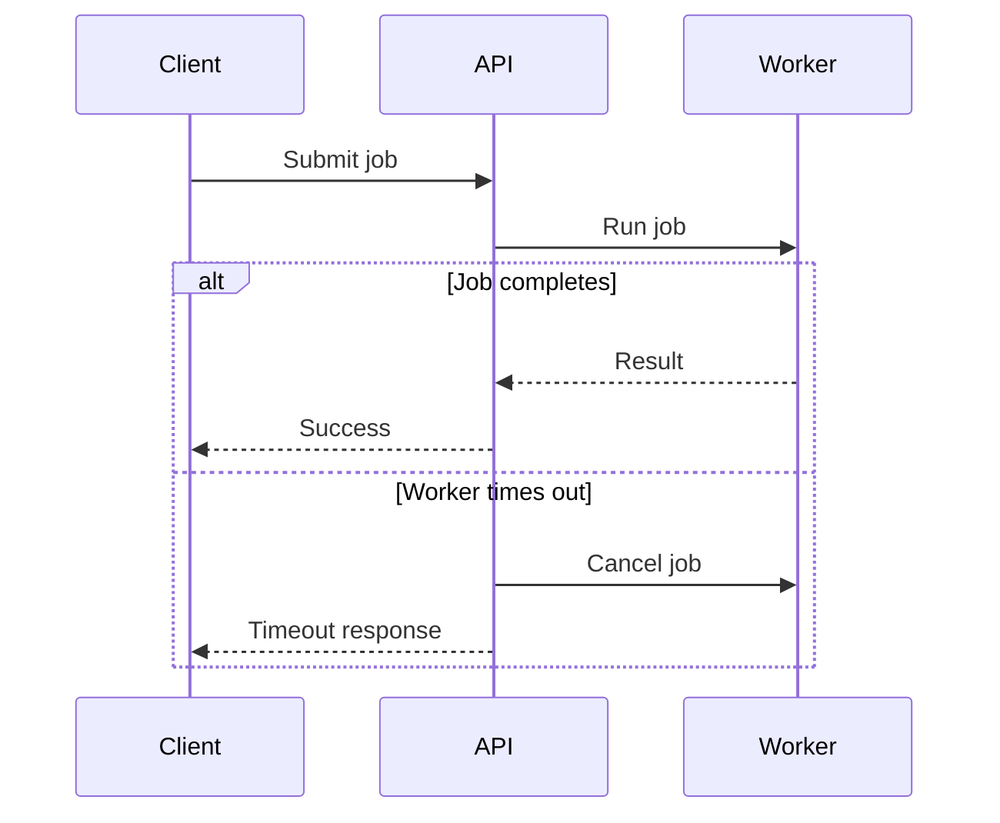

# SpecDown Read Aloud and Document Explanations Implementation Plan

Readers can listen to a spec, ask what a passage means, and follow up in a right rail with the source close at hand. The prototype covers prose, code, sections, whole documents and Mermaid diagrams.

## Platform decisions

| Surface | Read Aloud | Understanding the diagram | Entry point |
| --- | --- | --- | --- |
| iPhone | AVSpeechSynthesizer | Local Foundation Models when available, source walkthrough on every supported device | More → Explain… opens the full-width right rail |
| iPad | Same Swift adapter | Same providers as iPhone | More → Explain… opens the responsive right rail |
| Mac direct | Native Swift speech via Electron | Shared Apple provider and walkthrough | More → Explain… opens the right rail |
| Mac App Store | Same native component, qualified in the signed sandbox | Same as Mac direct, verified separately | Same Mac controls |
| Windows | Electron speech synthesis, subject to packaged voice tests | Source walkthrough | More actions menu and shared right rail |
| Linux | Electron speech synthesis, subject to installed voice and backend | Source walkthrough | More actions menu and shared right rail |
| Web and installed PWA | Browser speech synthesis when usable | Source walkthrough | More actions menu and shared right rail |

## Explain in the right rail

Open the existing **More actions (⋯)** menu and choose **Explain…**. On iPhone use the existing More action sheet to launch the rail. Capture the selection before the menu takes focus. The rail header names the target, for example **Selection · Retry policy**, and the body opens with a plain-language explanation and clickable source references. Initial scope follows the selection, explicitly focused code block or diagram, current section, then document. The scope picker also offers **Whole document**.

Keep the document visible on the left when width permits. At compact widths, including iPhone and narrow iPad Split View, the same rail fills the window from the trailing edge. Dismissing it restores reading position, selection and keyboard focus. Use SpecDown’s fonts, neutral surfaces, dividers, focus styles and reduced-motion treatment. Keep entry actions in the existing menu. Show playback controls only during a reading session.

Place the conversation in the rail, with **Ask a follow-up…** anchored at the bottom. Each answer uses the current scope, thread and document revision, and links back to supporting passages, code lines or diagram steps. A citation reveals the source and preserves the path back to the thread on compact screens. An explicit scope change starts a new thread. Dismissing the rail preserves the thread in memory for the same open document revision. Closing or editing the document invalidates it.

For example, select “The client retries twice after a timeout,” then ask “Does that also apply to a permission error?” If the selection is silent, say so and offer **Use whole document**. On eligible Apple devices, generate answers locally. When local AI is unavailable, explain availability in context and retain reading actions and the source walkthrough for supported diagrams.

## Implementation boundaries

The viewer owns text ranges, sentence order, playback state and source step IDs. A proposed speech adapter exposes `speak({sessionId, sentenceId, text, rate})`, `pause()`, `resume()`, and `stop()`. Platform events return the session and sentence IDs so a stale callback cannot highlight a different document. Use the existing bridge in `markdown-viewer/src/platform/bridge.js` and retain the iOS 16 deployment target.

Build a source walkthrough for the supported subset of Mermaid sequence diagrams. Each step identifies the branch, actor, recipient, message, and source occurrence. Model responses contain explanation text and supporting step IDs. The viewer validates those IDs, presents generated text as text, and offers the original steps. Apply the same source-grounding rule to prose, code and whole-document questions. Use section-sized inputs for long documents and disclose partial coverage. V1 uses local Apple inference. Other model providers and additional diagram types can be assessed after the prototype.

## Reference scenario

Expected answer: the API handles the timeout, sends Cancel job to the Worker, then returns Timeout response to the Client. A claim that the API retries is unsupported. Ask once after listening on iPhone and once with the walkthrough visible on iPad.

## Delivery order

Start the narration controller, source-scope resolver and sequence walkthrough independently. Once their interfaces work, connect the UI and build the mobile prototype. Use the physical iPhone and iPad findings to decide which UX to carry to the remaining apps. The desktop and browser adapters can be prepared independently as their inputs settle. Capture separate results for the two Mac distributions, Windows and Linux packages, browser and installed PWA.

## Verification

Focus on five failure cases: partial selections across inline markup, repeated messages on different branches, switching documents during speech or inference, unavailable voices or models, and model claims unsupported by the chosen source. Tests in the owning tickets cover each case. Run the scoped Jest suites, lint, typecheck and production build before native or browser qualification. A passing adapter mock establishes event behavior. Audible output, interruptions, sandbox loading and offline behavior require the packaged runtime.

## Tickets

### Shared reader and walkthrough

- [ ] **Build the document narration controller**. In `markdown-viewer/src/features/read-aloud.js`, create a queue of sentence text and DOM ranges scoped to the current render. Support reading the exact selection or starting at the visible heading and continuing through the document. Announce code and diagrams as skippable blocks. Expose start, pause, resume, stop and rate controls through a speech adapter. Tag callbacks with a session ID.

  Acceptance: A fake adapter test covers a partial sentence selection, inline markup, repeated sentences, and a code block followed by prose. The active sentence alone is highlighted. Switching tabs, editing, or re-rendering stops playback and removes the highlight. A late callback cannot restart it.

  Ready to start. [ZIL-253](https://linear.app/zilla151/issue/ZIL-253/build-the-document-narration-controller)

- [ ] **Build a source-linked walkthrough for Mermaid sequence diagrams**. Add a sequence walkthrough module alongside `markdown-viewer/src/features/diagrams.js`. Use the bundled Mermaid parser where its data preserves branch context. Represent participants, aliases, message order and alt/else labels as steps with stable references scoped to this render. Start with a synthetic Client/API/Worker diagram with success and timeout branches.

  Acceptance: Fixture tests assert exact sender, receiver, message and branch. Include identical messages on different branches. Activating a step identifies its occurrence in the rendered diagram or reveals its exact source span when visual mapping is unavailable. Unsupported syntax has a clear fallback.

  Ready to start. [ZIL-254](https://linear.app/zilla151/issue/ZIL-254/build-a-source-linked-walkthrough-for-mermaid-sequence-diagrams)

- [ ] **Connect the More menu to reading actions and the Explain right rail**. Use the existing More actions overflow (`features/toolbar-overflow.js`) and iPhone More action sheet. Add one contextual reading row (Read selection or Read from here) and one Explain… row. Capture the target before opening the menu. Mount the Explain right rail using the shared visual tokens and existing controls. On wide screens reserve space beside the document. On compact screens the rail occupies the available width from the trailing edge. Show pause, resume, stop and rate during playback. Listen can narrate a walkthrough or answer.

  Acceptance: Verify keyboard, touch and screen-reader journeys from More through the rail and back. Preserve selection, scroll and focus. Check both themes and reduced motion. Idle toolbar and diagram controls keep their existing layout. A missing voice leaves the walkthrough usable. Listening to an answer pauses document narration and offers Resume document at the saved sentence.

  Depends on ZIL-265, ZIL-254, ZIL-253. [ZIL-255](https://linear.app/zilla151/issue/ZIL-255/connect-the-more-menu-to-reading-actions-and-the-explain-right-rail)

- [ ] **Resolve Explain scope and map citations back to the document**. Snapshot the active document revision and reading position before More takes focus. Resolve the initial scope in order: nonempty document selection, explicitly focused code block or diagram, current heading section, then document. For a section include its content up to the next heading of equal or higher rank. Expose a scope name, preview, and source references. The panel can switch to the containing section or the whole document. Keep the original selection available during the session.

  Acceptance: Cover repeated prose, cross-block selections, fenced code, Mermaid, a headingless document and a document edited while a request is pending. Each citation reveals the correct occurrence. Changing scope cancels previous work. A whole-document result accounts for every section or discloses exactly which sections were covered.

  Ready to start. [ZIL-265](https://linear.app/zilla151/issue/ZIL-265/resolve-explain-scope-and-map-citations-back-to-the-document)

### iPhone and iPad prototype

- [ ] **Implement native narration on iPhone and iPad**. Add an AVSpeechSynthesizer adapter through `ios/SpecDown/WebBridge.swift`. Connect utterance IDs to shared sentence events and handle phone audio interruptions, cancellation and changes of voice or rate. Make the adapter reusable by the Mac shell.

  Acceptance: On a device, play a selection, pause, resume and stop. An interruption pauses cleanly and tab changes discard late events. Verify that narration works on the supported iOS 16 baseline without requiring model APIs. Record which voices work offline.

  Depends on ZIL-253. [ZIL-256](https://linear.app/zilla151/issue/ZIL-256/implement-native-narration-on-iphone-and-ipad)

- [ ] **Generate on-device explanations grounded in the selected document scope**. Use a Swift Foundation Models provider shared by eligible Apple targets. Accept scoped source excerpts, revision, source IDs, optional question and bounded history. Explain prose, code, a section, an entire document or a Mermaid diagram. For long texts process section-sized chunks and retain citations through synthesis. Cancel outdated requests and validate returned references before display.

  Acceptance: On device, test a requirement, fenced function, multi-section document and timeout diagram. Citations identify the correct original text or step. Verify an unknown answer, invalid reference, context overflow, model unavailable, offline after setup, and revision change mid-request. Disclose partial coverage if the entire document could not be processed. Preserve diagram walkthrough on failure.

  Depends on ZIL-265, ZIL-254. [ZIL-257](https://linear.app/zilla151/issue/ZIL-257/generate-on-device-explanations-grounded-in-the-selected-document)

- [ ] **Integrate the Explain right rail and follow-ups on iPhone and iPad**. Wire native adapters through `ios-wiring.js` and `ios-chrome.js`. Launch the rail via More on both devices. Use a trailing full-width panel on compact screens and a right-hand pane beside the document when space permits. The composer stays reachable with the software keyboard open. Listen uses the shared narration controls.

  Acceptance: Verify text selection survives opening More. With the keyboard open send two follow-ups on iPhone and follow a citation back to the text and then the thread. Test VoiceOver, focus return, rotation, iPad Split View, and independent voice/model availability.

  Depends on ZIL-266, ZIL-257, ZIL-255, ZIL-256. [ZIL-258](https://linear.app/zilla151/issue/ZIL-258/integrate-the-explain-right-rail-and-follow-ups-on-iphone-and-ipad)

- [ ] **Validate passage follow-ups and the timeout walkthrough on physical iPhone and iPad**. Use a sample spec with a retry requirement and timeout diagram. On each device open Explain from More, read the selected requirement, ask about permission errors, expand scope explicitly and inspect a citation. Test the diagram audio-first on iPhone and beside its source on iPad.

  Acceptance: Record device, build, OS, voice, model state, whether the reader could find the answer unaided and whether the source supports it. Check the timeout handler and next message, compact rail navigation, the software keyboard and model-unavailable fallback.

  Depends on ZIL-258. [ZIL-259](https://linear.app/zilla151/issue/ZIL-259/validate-passage-follow-ups-and-the-timeout-walkthrough-on-physical)

- [ ] **Continue an explanation with a scoped follow-up conversation**. In the Explain right rail show the scope, first answer, and its citations, followed by a labeled “Ask a follow-up…” field anchored at the bottom of the rail. Append questions and answers in reading order. Use bounded conversation history and the same document revision and scope for each turn. Make Stop and Retry available for the relevant turn. Offer “Use whole document” when the reader wants broader context. On scope change, start a fresh thread and show its new scope. Keep the thread in memory while the same document and scope stay open, including dismissing and reopening the panel. Clear it on document close or revision change.

  Acceptance: Ask a pronoun-based follow-up to a selected requirement and verify it resolves against the previous turn and cites the source passage. Ask an unanswered question and verify uncertainty. Expanding scope is explicit. Test repeated sends, cancellation, reopening, switching files and late replies. Screen readers announce new answers once and keyboard focus remains usable. With an unavailable model the rail explains availability and exposes supported source actions.

  Depends on ZIL-257, ZIL-255. [ZIL-266](https://linear.app/zilla151/issue/ZIL-266/continue-an-explanation-with-a-scoped-follow-up-conversation)

### Mac, Windows, Linux and web

- [ ] **Connect native speech and local AI to direct-download Mac**. Bridge the shared Apple adapters to the Electron main process through `desktop/native/`, `desktop/main.js`, `desktop/preload.js` and `markdown-viewer/src/platform/bridge.js`. Use bounded, cancellable requests from the bundled viewer. Use the shared More menu and Explain right rail.

  Acceptance: Exercise a packaged Dev app on an eligible Mac and the model-unavailable path. Check sentence highlighting, stop on window close, a cited timeout answer and Listen. Verify older supported macOS configurations can launch and use available features. Verify a prose follow-up and a citation jump while the rail stays open.

  Depends on ZIL-256, ZIL-255, ZIL-257, ZIL-266. [ZIL-260](https://linear.app/zilla151/issue/ZIL-260/connect-native-speech-and-local-ai-to-direct-download-mac)

- [ ] **Qualify the sandboxed Mac App Store edition**. Integrate the native reader component with the existing Mac App Store packaging path. Check bundled component loading, signing and sandbox behavior in the signed Store Dev app. Reuse the direct-download Mac controls.

  Acceptance: Open a local spec through the Store app and run Read selection, Explain, and Listen. Record successful sandboxed playback and model detection or an accurate unavailable state. Reopening a second file must not reuse its predecessor’s explanation. Record Store evidence separately from direct Mac.

  Depends on ZIL-260. [ZIL-261](https://linear.app/zilla151/issue/ZIL-261/qualify-the-sandboxed-mac-app-store-edition)

- [ ] **Implement browser narration for web and installed PWA**. Add a `speechSynthesis` adapter under `markdown-viewer/src/platform/`. Handle asynchronous voice discovery, user-initiated playback, and cancellation. Prefer an installed local voice for offline reading and distinguish service-backed voices before using them. Keep the shared walkthrough available without model or voice support.

  Acceptance: Test in Safari and Chromium and an installed PWA. Cover an initially empty voice list, no suitable voice, stopped playback and offline replay with a verified local voice. Record observed support. An unsupported browser can still navigate all walkthrough steps.

  Depends on ZIL-255. [ZIL-262](https://linear.app/zilla151/issue/ZIL-262/implement-browser-narration-for-web-and-installed-pwa)

- [ ] **Qualify narration in packaged Windows and Linux apps**. Exercise the shared browser speech adapter in the Windows Electron installer and Linux AppImage. Detect actual voice and engine behavior after launch. If Electron exposes the API but produces no playback, show an actionable unavailable state. Record whether a native speech follow-up is needed.

  Acceptance: Record OS, package, voice/backend, audible output, pause/resume, rate and sentence tracking independently on Windows and Linux. Test missing voice/service and verify the timeout walkthrough remains usable in both packages.

  Depends on ZIL-262. [ZIL-263](https://linear.app/zilla151/issue/ZIL-263/qualify-narration-in-packaged-windows-and-linux-apps)

### Cross-platform acceptance

- [ ] **Verify platform coverage and make the rollout decision**. Run the same selection, narration, diagram and fallback scenarios on iPhone, iPad, Mac direct, Mac Store, Windows, Linux, browser and installed PWA. Report speech, local AI and walkthrough outcomes independently. Include keyboard or screen-reader use, mismatched citations and stale callbacks. Include the right rail at wide and compact widths and test follow-ups across passage, code, section, diagram and whole-document scopes wherever local AI is available.

  Acceptance: Publish a table of build, device/runtime, capability, observed result and outstanding defect. Record a ready/hold decision for each surface and link follow-up issues for gaps. Production rollout remains a separate decision. Confirm accurate capability messaging on systems without a model.

  Depends on ZIL-263, ZIL-261, ZIL-260, ZIL-259, ZIL-262. [ZIL-264](https://linear.app/zilla151/issue/ZIL-264/verify-platform-coverage-and-make-the-rollout-decision)

[Linear implementation plan](https://linear.app/zilla151/document/implementation-plan-and-platform-matrix-76a9fab6a362)
