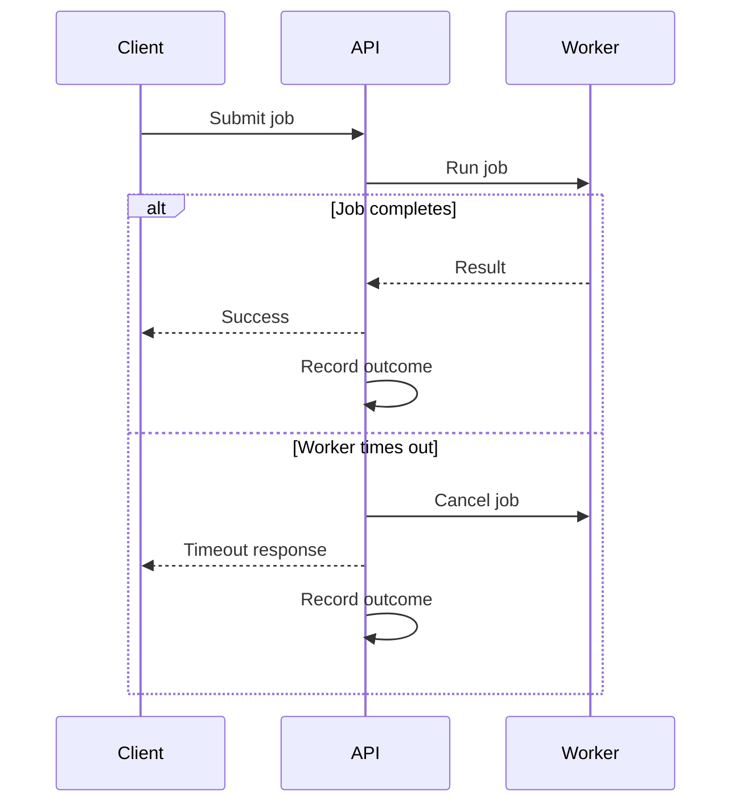

# Job client contract

## Retry policy

The client **retries twice** after a timeout. It uses the original job identifier for both retries.

## Permission errors

The client must report a permission error immediately. It must never retry a denied request.

```js
function shouldRetry(error, attempts) {
  return error === 'timeout' && attempts < 2;
}
```

## Worker lifecycle


